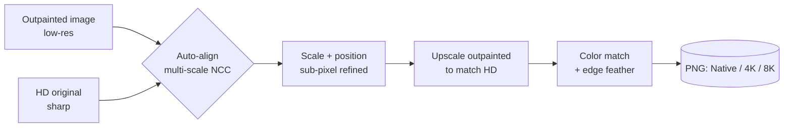

<div align="center">


# HD Patch

**Put your sharp HD original back into an outpainted image, seamlessly and 100% on your device.**

<br>
<a href="https://github.com/BR1JM0H4N/Hd-Patch/releases/"></a>
<a href="https://br1jm0h4n.github.io/Hd-Patch/"></a>
<a href="https://github.com/BR1JM0H4N/Hd-Patch"></a>

<br>

<!-- Platform -->


<!-- Web stack -->


<!-- Repo -->
<a href="https://github.com/BR1JM0H4N/Hd-Patch/stargazers"></a>
<a href="https://github.com/BR1JM0H4N/Hd-Patch/network/members"></a>
<a href="https://github.com/BR1JM0H4N/Hd-Patch/issues"></a>
<a href="https://github.com/BR1JM0H4N/Hd-Patch/commits"></a>


<a href="LICENSE"></a>


</div>

<br>

## 🌟 What is HD Patch?

AI outpainting tools (Generative Fill, Gemini, Stable Diffusion and friends) are great at extending a picture, but they hand back a **downscaled, compressed** result. Your carefully made HD original ends up blurry inside the bigger canvas.

**HD Patch fixes that.** Give it the low-res outpainted picture and your crisp original, and it:

1. 🔎 **Finds** exactly where the original sits, using multi-scale Normalized Cross-Correlation (NCC) with sub-pixel refinement.
2. 📐 **Upscales** the outpainted image so the original lines up 1:1, which means your HD pixels are never resized in the default output.
3. 🎨 **Blends** the sharp pixels back in, with local color matching and a soft edge so there's no visible box.

Everything runs in your browser. **No uploads, no servers, no accounts.**

<br>

## 🔄 How it works



<br>

## ✨ Features

| | Feature | Details |
|---|---|---|
| ⚡ | **Auto-align** | Multi-scale coarse search, then coordinate-descent refinement for sub-pixel scale and position. |
| 👁️ | **Three view modes** | **Overlay** with adjustable opacity, **Difference** (a perfect fit turns dark) and a live **Result** preview. |
| 🫳 | **Touch-first controls** | Drag to move, pinch or scroll to scale, plus a "hold to see the original" compare button. |
| 🎛️ | **Fine tune** | Nudge pad with 4 / 1 / 0.2 px steps and scale buttons of ±1% and ±0.1%. Arrow keys work too. |
| 🎨 | **Smart blending** | Adjustable edge feather and low-frequency color matching to hide seams. |
| 📐 | **Flexible export** | Native HD pixels, 4K or 8K long side, saved as PNG. |
| 🔒 | **Private by design** | 100% client-side with the Canvas API. Your images never leave your device. |
| 📱 | **Installable** | Runs as a PWA and packages into an Android app with Capacitor. |
| 🌗 | **Material 3 UI** | Android 16 style theming that follows your dynamic color tokens. |

> [!NOTE]
> Alignment handles **scale and position**. If your outpainted image was also rotated or warped, use the manual controls to finish.

<br>

## 🚀 Live demo

**👉 https://br1jm0h4n.github.io/Hd-Patch/**

No install needed. Open it on any modern desktop or mobile browser.

<br>

## 📖 Usage

1. **Add images.** Pick the low-res **Outpainted** image and your sharp **HD original**.
2. **Align.** Press **Auto-align**, or place the HD image by hand. Switch to **Difference** to check: black means a match.
3. **Blend.** Set the edge feather and color match, then choose an output size.
4. **Export.** Press **Create PNG**, then **Save PNG**.

<details>
<summary><b>⌨️ Tips for a perfect result</b></summary>

<br>

- Use full-size files. Downscaled copies lose the very detail you're trying to keep.
- Keep **Native** output if you want the HD pixels untouched. **4K / 8K** also stretch the HD part.
- A feather of about **10 px** keeps edges clean. Larger values can ghost small details the AI redrew, like text on notes.
- If the match score is low, zoom in with **Difference** view and nudge with 0.2 px steps.

</details>

<br>

## 📱 Build the Android app (Capacitor)

HD Patch is a single static web app, so wrapping it with [Capacitor](https://capacitorjs.com) takes a few minutes.

```bash
# 1. Install Capacitor
npm init -y
npm install @capacitor/core @capacitor/cli @capacitor/android

# 2. Put the web files in a folder Capacitor can serve
mkdir www
cp index.html logo.png www/        # plus any other app files

# 3. Initialise and add Android
npx cap init "HD Patch" com.br1jm0h4n.hdpatch --web-dir=www
npx cap add android

# 4. Sync and open in Android Studio
npx cap sync android
npx cap open android
```

> [!TIP]
> Saving files from a WebView can behave differently from a browser. If **Save PNG** doesn't work in your build, add `@capacitor/filesystem` and `@capacitor/share` and hand the PNG to them.

<br>

## 🛠️ Tech stack

| Layer | Technology |
|---|---|
| UI | HTML5, CSS3 (Material 3 tokens), vanilla JavaScript |
| Imaging | Canvas API, image pyramids, normalized cross-correlation |
| App shell | Progressive Web App, Ionic Capacitor for Android |
| Hosting | GitHub Pages |

<br>

## 🤝 Contributing

Contributions, bug reports and ideas are very welcome.

1. Fork the project
2. Create your branch: `git checkout -b feature/AmazingFeature`
3. Commit your changes: `git commit -m "Add AmazingFeature"`
4. Push the branch: `git push origin feature/AmazingFeature`
5. Open a Pull Request

<br>

## 📄 License

Distributed under the **MIT License**. See [`LICENSE`](LICENSE) for details.

<br>

<div align="center">

Made with 💚 by **[BR1JM0H4N](https://github.com/BR1JM0H4N)**

If HD Patch saved your pixels, consider giving it a ⭐

</div>
